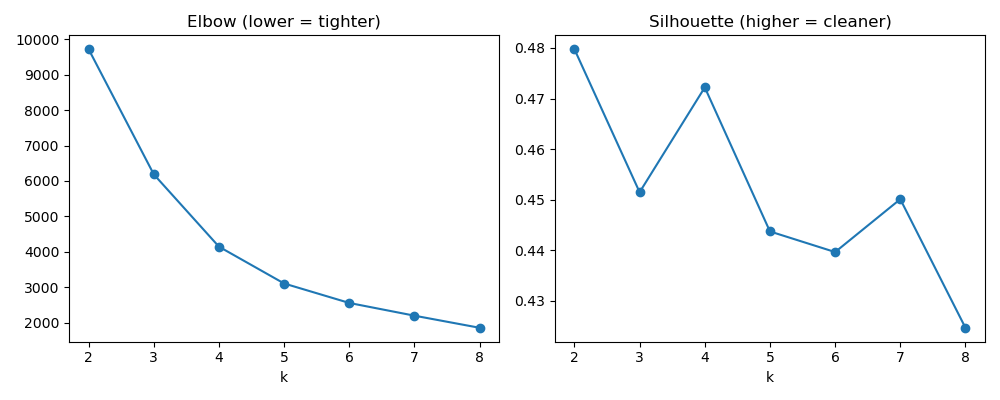

# Day 15: Unsupervised learning

Focus: clustering + representations set up embeddings.

| Supervised (Days 11 to 14) | Unsupervised (today) |
|---|---|
| Data has the answer (`SalePrice`, `Churn`) | No answer column |
| Model learns to predict the answer | Model finds groups by itself |

## Task 1: Clustering and choosing k

### KMeans (ice-cream stall example)

Place `k` ice-cream stalls in a school:

1. Put `k` stalls at random spots.
2. Every kid walks to the **nearest** stall.
3. Each stall moves to the **middle** of its kids.
4. Repeat 2 and 3 until the stalls stop moving.

Stall = cluster center. `k` = number of stalls.

### Setup

- Data: Telco churn (Day 7), 7043 customers.
- Features: `tenure`, `MonthlyCharges`, `TotalCharges`, scaled with `StandardScaler`. KMeans uses distance, so without scaling `TotalCharges` (0 to 8000) would decide everything.
- `k` = 2 to 8, `n_init=10`, `random_state=42`.

Code: [`labs/d15-unsup/clusters.py`](../labs/d15-unsup/clusters.py)

### Two ways to judge k

| Tool | Measures | Read it |
|---|---|---|
| **Inertia** (elbow) | Total distance from each point to its center | Always drops as k grows (k = every customer → 0), so look for the **elbow**, where the drop slows down |
| **Silhouette** | How cleanly groups are separated (-1 to +1) | Higher is better |

### Results

| k | Inertia | Drop from previous | Silhouette |
|---|---|---|---|
| 2 | 9,712 | | **0.480** (best) |
| 3 | 6,186 | 3,526 | 0.451 |
| 4 | 4,148 | 2,038 | **0.472** (2nd best) |
| 5 | 3,111 | 1,037 | 0.444 |
| 6 | 2,563 | 548 | 0.440 |
| 7 | 2,204 | 359 | 0.450 |
| 8 | 1,863 | 341 | 0.425 |

### Pick: k = 4

- **Elbow:** big drops up to k = 4, then the drop halves (1,037) and keeps shrinking. Extra groups after 4 add little.
- **Silhouette:** 0.472 at k = 4 is almost the same as the best (0.480 at k = 2). Groups are still clean.
- **Business:** k = 2 only says "old vs new customers", which we already knew. k = 4 gives more useful segments to act on.
- k = 2 has the best silhouette but sits high on the elbow (inertia 9,712, groups are loose).

**Rule:** no single plot decides. Take the k where both plots agree well enough, then check that the groups are useful.
