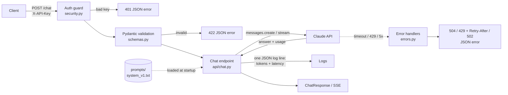

# LLM Chat Service

A small, production-shaped API in front of **Claude**. Send a prompt, get an answer back, either all at once or streamed word by word. Every request is authenticated, validated, logged with token usage and latency, and every failure comes back as clean JSON.

> **Project 1 of 7** in my [90-day AI Engineer journey](../../README.md).

<!-- TODO: add a real screenshot or GIF of streaming, save it as docs/streaming.png, then uncomment the next line -->
<!--  -->

---

## Run it in 3 steps

You need **[Docker](https://docs.docker.com/get-docker/)** and a **[Claude API key](https://platform.claude.com/)**.

**1. Clone and enter the project**
```bash
git clone https://github.com/ShivamPrajapati20/ai-engineer-journey.git
cd ai-engineer-journey/projects/p1-chat-api
```

**2. Add your keys**
```bash
cp .env.example .env          # Windows: copy .env.example .env
```
Open `.env` and set:
- `ANTHROPIC_API_KEY`: your Claude key (`sk-ant-...`)
- `SERVICE_API_KEY`: any long random string. Clients must send it in the `X-API-Key` header.

**3. Build and run**
```bash
docker build -t llm-chat-service .
docker run --rm -p 8000:8000 --env-file .env llm-chat-service
```

Open **http://127.0.0.1:8000/docs**, click **Authorize 🔒**, paste your `SERVICE_API_KEY`, and try `POST /chat`.

---

## Try it from the terminal

```bash
# Health check (no key needed)
curl http://127.0.0.1:8000/health

# Ask a question
curl -X POST http://127.0.0.1:8000/chat \
  -H "Content-Type: application/json" \
  -H "X-API-Key: YOUR_SERVICE_API_KEY" \
  -d '{"prompt": "What is RAG in one sentence?"}'

# Stream the answer as it is generated (-N = don't buffer)
curl -N -X POST http://127.0.0.1:8000/chat/stream \
  -H "Content-Type: application/json" \
  -H "X-API-Key: YOUR_SERVICE_API_KEY" \
  -d '{"prompt": "Explain RAG in 5 sentences."}'
```
<details>
<summary>Windows PowerShell versions</summary>

Use `curl.exe` (plain `curl` is a different command in PowerShell) and escape the JSON quotes:
```powershell
curl.exe http://127.0.0.1:8000/health
curl.exe -X POST http://127.0.0.1:8000/chat -H "Content-Type: application/json" -H "X-API-Key: YOUR_SERVICE_API_KEY" -d '{\"prompt\": \"What is RAG in one sentence?\"}'
curl.exe -N -X POST http://127.0.0.1:8000/chat/stream -H "Content-Type: application/json" -H "X-API-Key: YOUR_SERVICE_API_KEY" -d '{\"prompt\": \"Explain RAG in 5 sentences.\"}'
```
</details>

**Example `/chat` response**
```json
{
  "answer": "RAG (Retrieval-Augmented Generation) retrieves relevant documents and gives them to the model so it can answer from them.",
  "model": "claude-haiku-5-5",
  "input_tokens": 312,
  "output_tokens": 31,
  "latency_ms": 840
}
```

**Example `/chat/stream` output** (Server-Sent Events)
```
event: token
data: {"text": "RAG "}

event: token
data: {"text": "retrieves "}
...
event: done
data: {"model": "claude-haiku-5-5", "input_tokens": 312, "output_tokens": 120, "latency_ms": 2140}
```

---

## Endpoints

| Method | Path | Auth | What it does |
|---|---|---|---|
| `POST` | `/chat` | `X-API-Key` | Returns the full answer with token counts and latency |
| `POST` | `/chat/stream` | `X-API-Key` | Streams the answer as SSE: `token` events, then `done` (or `error`) |
| `GET` | `/health` | none | `{"status": "ok", "version": "..."}` for load balancers and Docker |

**Request body** (both chat endpoints)

| Field | Type | Rules |
|---|---|---|
| `prompt` | string | required, 1–8,000 characters, surrounding spaces stripped |
| `max_tokens` | int | optional, default 512, range 1–4,096 (caps cost) |
| `temperature` | float | optional, default 0.7, range 0–2. Validated but not sent: current Claude models reject sampling parameters |

---

## Architecture



Bad requests are rejected **before** the model is called, so they cost nothing.

---

## Errors

Every error has the same shape and **never** includes a stack trace:
```json
{"error": {"code": "rate_limited", "message": "Too many requests to the model provider. Please retry later."}}
```

| Situation | Status | `code` | What the client should do |
|---|---|---|---|
| Missing or wrong `X-API-Key` | **401** | `unauthorized` | Fix the key |
| Prompt > 8,000 chars, bad `temperature`, etc. | **422** | `invalid_request` | Fix the request |
| Claude rate limit | **429** + `Retry-After` | `rate_limited` | Wait `Retry-After` seconds, retry |
| Claude server error (5xx) | **502** | `provider_error` | Retry later |
| Claude unreachable | **502** | `provider_unreachable` | Retry later |
| Claude too slow | **504** | `provider_timeout` | Retry later |
| Bug in this service | **500** | `internal_error` | Report it |

During streaming the status is already `200`, so failures arrive as an `event: error` with the same `code` and `message`.

---

## Configuration

All settings come from `.env` (or environment variables, which take priority).

| Variable | Required | Default | Purpose |
|---|---|---|---|
| `ANTHROPIC_API_KEY` | ✅ | | Your Claude key |
| `SERVICE_API_KEY` | ✅ | | Key clients must send in `X-API-Key` |
| `MODEL_NAME` | | `claude-haiku-5-5` | Claude model to call |
| `SYSTEM_PROMPT_PATH` | | `prompts/system_v1.txt` | Versioned system prompt |
| `REQUEST_TIMEOUT_SECONDS` | | `30` | Give up on Claude after this long → 504 |
| `MAX_RETRIES` | | `2` | Automatic retries on 429 / 5xx / timeouts |
| `LOG_LEVEL` | | `INFO` | `DEBUG`, `INFO`, `WARNING`, `ERROR` |

`.env` is git-ignored and excluded from the Docker image (`.dockerignore`). It's passed in at runtime with `--env-file`.

---

## Logs

One structured JSON line per model call:
```
INFO app.api.chat {"event": "llm_call", "endpoint": "/chat", "model": "claude-haiku-5-5", "prompt_chars": 27, "input_tokens": 312, "output_tokens": 31, "latency_ms": 840}
```

---

## Tests

The model provider is **mocked**, so tests make **zero network calls** and cost nothing. They run in under a second.

```bash
python -m pip install -r requirements-dev.txt
python -m pytest -v
```

9 tests cover: the happy path, missing and wrong keys (401), oversized prompt and bad temperature (422), provider timeout (504), rate limit with `Retry-After` (429), provider 5xx without a stack trace (502), and the open `/health` endpoint.

---

## Run without Docker

```bash
python -m pip install -r requirements.txt
python -m fastapi dev app/main.py        # needs: python -m pip install "fastapi[standard]"
# or: python -m uvicorn app.main:app --reload
```

---

## Project structure

```
p1-chat-api/
├── app/
│   ├── main.py            # creates the app, error handlers, routers, /health
│   ├── schemas.py         # ChatRequest / ChatResponse (Pydantic)
│   ├── api/chat.py        # POST /chat, POST /chat/stream
│   └── core/
│       ├── config.py      # settings from .env (pydantic-settings)
│       ├── security.py    # X-API-Key check → 401
│       ├── errors.py      # every failure → {"error": {code, message}}
│       └── log.py         # structured logging
├── prompts/system_v1.txt  # system prompt: role, task, constraints, format, refusal rule
├── tests/                 # pytest, provider mocked
├── Dockerfile
├── requirements.txt       # runtime
├── requirements-dev.txt   # + test tools
└── .env.example
```

---

## Tech stack

Python 3.12 · FastAPI · Pydantic v2 · pydantic-settings · Anthropic Python SDK · Uvicorn · pytest · Docker
